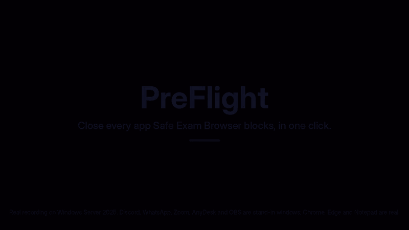

# PreFlight

**Close every app Safe Exam Browser complains about, in one click.**

Before an online test, Safe Exam Browser (SEB) refuses to start until you quit Discord, Teams, WhatsApp, screen recorders, other browsers and more. Hunting each one down in Task Manager takes minutes and you always miss one. PreFlight finds them all, ticks the ones SEB usually blocks, and closes them for you.



**[Watch the full demo video (45 s, MP4)](docs/preflight-demo.mp4)**. It's a real recording of PreFlight on a Windows Server 2025 machine, made by [this workflow](.github/workflows/demo.yml). Discord, WhatsApp, Zoom, AnyDesk and OBS are stand-in windows. Chrome, Edge and Notepad are real. The pointer is drawn from the recorder's log because cloud machines have no mouse.

## Features

- **One click.** Apps SEB usually blocks are ticked for you, grouped as chat and calls, screen capture, remote access, other browsers, AI assistants and virtual cameras.
- **Learns your exam.** Type the names SEB showed you (`Discord.exe, Teams.exe`) once, and they're ticked every time after that.
- **Gentle, then firm.** Apps get a few seconds to ask you to save, then anything still open is closed, including every helper process.
- **Can't break Windows.** Windows itself, drivers, antivirus, OneDrive and SEB are never listed or closed. Only apps in your own login are touched, and background helpers without a window are left alone unless you add them.
- **Handles admin apps.** If something runs as administrator, PreFlight offers to restart with the rights to close it.
- **Opens SEB** when you're done, and links to Windows' startup settings so fewer apps come back next time.
- **Nothing to install.** Uses the PowerShell that ships with Windows 10 and 11.

## Get it

1. Click **Code → Download ZIP** on this page.
2. Right-click the ZIP, open **Properties**, tick **Unblock**, click **OK**, then extract it.
3. Double-click **`Create desktop shortcut.bat`** once.

## Use it before a test

1. Open **PreFlight** from your desktop.
2. Check the ticked apps. Untick anything you want to keep.
3. Click **Close N apps**.
4. Click **Open Safe Exam Browser**, or use your test link.

If SEB still lists something, click **Add SEB's list...**, type the names it shows, and save.
Right-click any app to always tick it or hide it.

## How it works

| Step | What PreFlight does |
| --- | --- |
| Scan | Reads running processes in your Windows session and groups them by app |
| Sort | Matches about 120 known process names to categories, then adds your own list |
| Close | Sends each app's main window a normal close request, waits up to 3.5 s, then ends what's left |
| Remember | Saves your lists to `%APPDATA%\PreFlight\settings.json` |

PreFlight only closes apps before your test. It doesn't hide anything from Safe Exam Browser or change how SEB works.

## Files

```text
PreFlight.ps1                   The app (Windows PowerShell 5.1, WinForms)
PreFlight.bat                   Double-click launcher
Create desktop shortcut.bat     Adds a desktop icon
demo/record-demo.ps1            Drives the app for the demo recording
.github/workflows/demo.yml      Records the demo on a real Windows machine
```

## Author

**Hemashree V. I.** · [@HemashreeVI](https://github.com/HemashreeVI)
